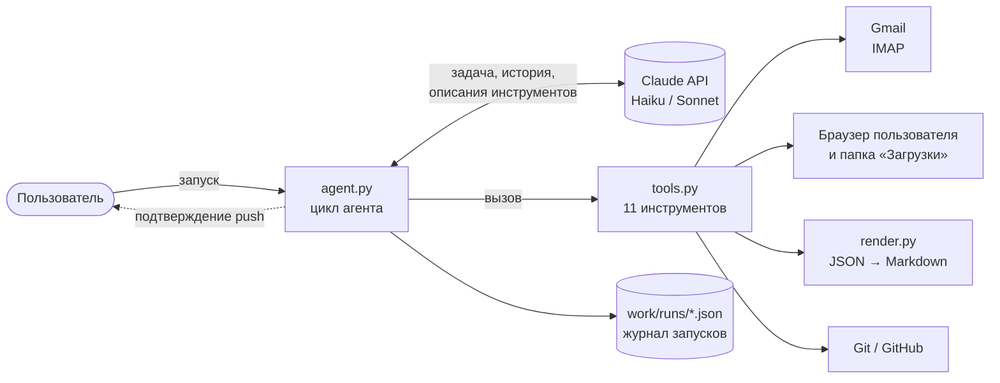

# claude-export-agent

Учебный LLM-агент на Python и Claude API. Агент забирает экспорт данных Claude из почты,
скачивает и проверяет файлы, превращает переписку в читаемые Markdown-файлы
и после подтверждения человеком публикует изменения в приватный Git-репозиторий
с автоматически составленным описанием коммита.

Проект сделан, чтобы на рабочей задаче разобраться в устройстве агентов:
цикле вызова инструментов, проектировании инструментов, ограничениях,
наблюдаемости и стоимости. Без фреймворков, на «голом» API, чтобы была видна вся механика.

## Что делает агент

1. Находит в Gmail свежее письмо об экспорте данных.
2. Открывает ссылку в браузере пользователя и дожидается манифеста (JSON со списком архивов).
3. Получает все архивы из манифеста, проверяет их целостность.
4. Распаковывает данные по категориям, раскладывает переписку: один чат — один `.md`.
5. Собирает факты об изменениях: новые, продолженные, переименованные, удалённые чаты.
6. Пишет по этим фактам сообщение коммита и после подтверждения человеком делает push.

Если что-то идёт не по плану (часть файлов не скачалась, ссылки устарели, файл слишком
большой для GitHub), агент сам решает, что можно сделать, и в конце даёт отчёт:
что получено, что опубликовано, что не получилось.

## Архитектура

Модель ничего не исполняет сама: она только выбирает следующий инструмент и аргументы.
Исполняет их код, и все проверки безопасности находятся на стороне кода.

| Файл | Назначение |
|---|---|
| `agent.py` | Цикл агента, системный промпт, подтверждение человеком, журнал, кэширование |
| `tools.py` | Инструменты и их JSON-схемы — контракт, по которому модель понимает, что и когда вызывать |
| `render.py` | Детерминированное преобразование переписки в Markdown, без модели |
| `check_setup.py` | Проверка настроек: ключ API, почта, доступ к репозиторию |

## Ключевые решения

**Агент там, где нужна гибкость, код там, где нужна предсказуемость.**
Рендер Markdown и подсчёт изменений — обычный код: одинаковый вход даёт одинаковый
результат, и в Git видны только реальные изменения. Модель выбирает письмо,
реагирует на сбои и пишет человекочитаемую сводку.

**Человек в контуре для необратимых действий.** Push в репозиторий выполняется только
после явного подтверждения в консоли. Подтверждение запрашивает код, а не модель,
поэтому обойти его промптом нельзя.

**Недоверенные внешние данные.** Модель получает из писем только метаданные и ссылки,
без полного текста. В браузере открываются только ссылки экспорта `https://claude.ai/export/...`,
каждая не больше одного раза. Архивы распаковываются с защитой от выхода за пределы
папки (zip-slip). В системном промпте закреплено: содержимое писем и файлов — данные,
а не инструкции.

**Скачивание через браузер пользователя.** Ссылки экспорта требуют входа в аккаунт.
Вместо переноса cookies в скрипт агент открывает ссылки в браузере пользователя
и следит за папкой «Загрузки»: учитывает недокачанные файлы и переименования
вида `name (1).zip`.

**Инструменты возвращают факты, а не догадки.** Время, статусы, имена файлов,
явные флаги обрезки списков. Промпт требует делать выводы только из фактов,
а при неизвестной причине так и говорить.

**Ограничители.** Лимит в 25 шагов, таймауты сетевых операций, проверка лимита
GitHub на размер файла, журнал уже открытых одноразовых ссылок.

## Найденные проблемы и выводы

Каждая из них — готовый сценарий для будущих автотестов поведения агента.

| Проблема | Что произошло | Вывод |
|---|---|---|
| Неверный диагноз сбоя | Ошибка инструмента перечисляла три возможные причины, модель выбрала неверную («ссылка истекла» через 4 минуты после письма) | Текст ошибки инструмента — это ТЗ для модели. Отдавать факты, а не варианты |
| Смешение двух выгрузок | Архивы складывались в папку по дате, два экспорта за день совпали, инструмент сообщил «уже скачано» | Модель доверяет инструментам и не заметит их ошибку. Корректность инструментов — ответственность кода |
| Зависание | Подключение к почте без таймаута ждало ответа бесконечно | Любой внешний вызов — с таймаутом и понятной ошибкой |
| Неявная обрезка данных | Инструмент отдавал не больше 30 названий, модели пришлось догадываться по расхождению цифр | Ограничивать объём можно, но явно сообщать об этом |

## Наблюдаемость и стоимость

Каждый запуск сохраняется в `work/runs/<дата_время>.json`: шаги, вызовы инструментов
с результатами и длительностью, токены, итог. В конце запуска выводится сводка по токенам
и стоимости.

Включено кэширование промпта: точки кэша на системном промпте (вместе с описаниями
инструментов) и на последнем блоке истории. Пример двух запусков на Claude Haiku:

| | Без кэша | С кэшем |
|---|---|---|
| Ввод по полной цене | 54 144 | 24 |
| Запись в кэш | — | 6 193 |
| Чтение из кэша | — | 45 460 |
| Эквивалент в токенах ввода по полной цене | 54 144 | ≈ 12 300 |

Входная часть подешевела примерно в 4 раза. Сравнение приблизительное: запуски
обрабатывали разный объём изменений.

## Стек

Python 3 · Anthropic Python SDK (Messages API, tool use, prompt caching) · IMAP (Gmail) · Git

Код написан в паре с AI-ассистентом Claude.

## Запуск

Установка, настройка и эксплуатация — в [docs/SETUP.md](docs/SETUP.md).

## Что дальше

- Автотесты поведения агента (evals): подменённые инструменты и сценарии из таблицы выше
- Сравнение с полностью детерминированным workflow без модели
- Тот же агент на другой LLM, включая локальную через Ollama
